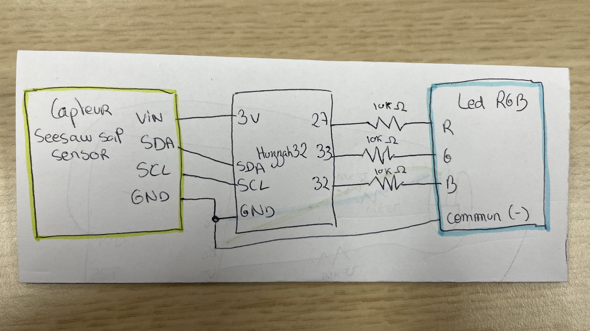
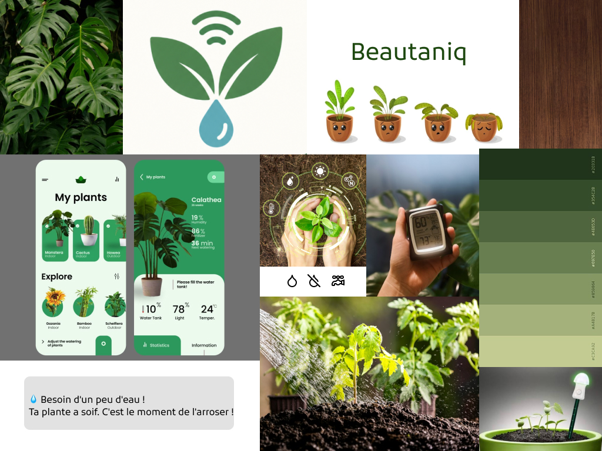
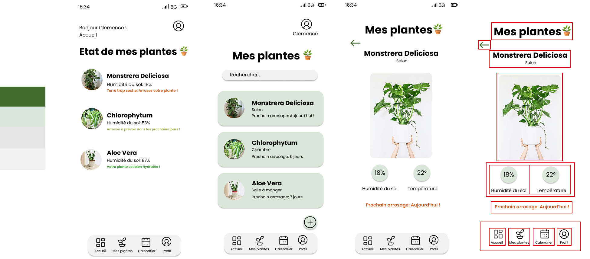
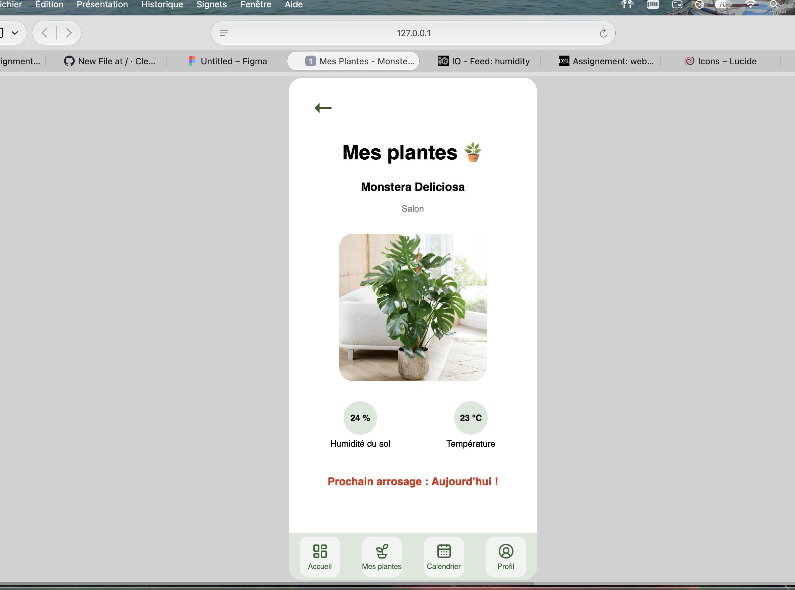

# Clémence's humidity sensor 

Voici la table des matières de mon rendu
- [Code of the electronic part↗](sketch.ino)
- [schematic view](#schematic-view)
- [Moodboard](#moodboard)
- [UI on figma](#figma-ui)
- [Code of the web part↗](index.html)
- [Video](#video)

## schematic view
<picture>
    
</picture>

This prototype uses an Adafruit HUZZAH32, along with a led RGD and a SEESAW humidity soil sensor. It also includes jumper wires.

## Moodboard

<picture>
  
</picture>

## Figma UI
<picture>
  
</picture>

https://www.figma.com/design/0twv519sDaI96A7JBuT8Np/Untitled?node-id=11-2&t=gPSDxTeSbLWZsCCd-1 

## Web part
Here is a preview of my web page. 

<picture>
  
</picture>

## Video

[See the video on youtube↗](https://youtu.be/7-YfWs-cX3M)